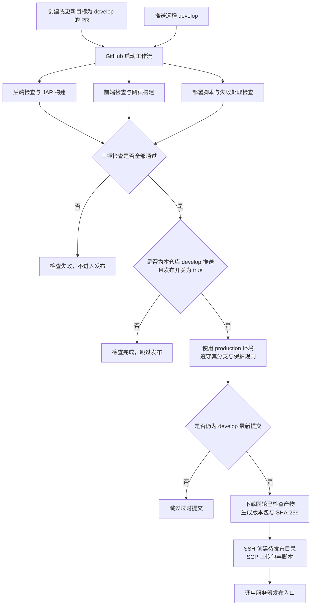
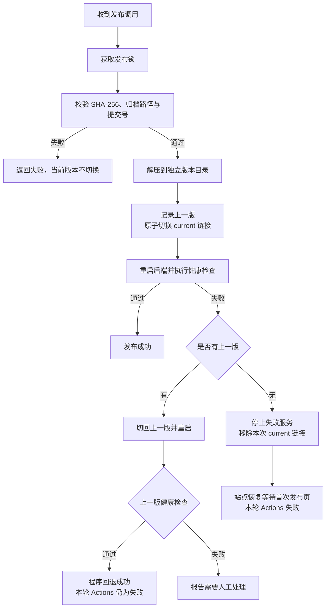

# CI/CD 流程说明

[ci-cd.yml](ci-cd.yml) 定义当前流程：GitHub 托管机器负责检查、构建和通过 SSH 上传，腾讯云服务器负责切换版本、重启后端及检查启动结果。服务器无需安装自托管 Runner，也不承担项目编译和应用测试。

CI（持续集成）用于检查修改能否正常编译、通过测试；CD 在这里指检查通过后自动部署。创建 PR 不会自动合并代码。

本文说明源码定义的行为，不代表新版流程已经在线上发布成功。截至 2026-11-20，服务器连接和发布前只读检查通过，GitHub 配置已核对，`AUTO_DEPLOY_ENABLED=false`，[PR #4](https://github.com/kanno111/foodmap/pull/4) 已进入实际检查阶段，正式发布待进行。实际检查结果以 PR 最新 Actions 为准，后续进度见[实施计划](../../docs/plans/cicd-improvements.md)。

## 提交、推送与 PR

| 操作 | 含义 | 当前工作流的反应 |
| --- | --- | --- |
| 本地提交（commit） | 在电脑上保存一组修改记录 | 不触发 |
| 推送普通功能分支（push） | 将提交上传到 GitHub 的该分支 | 单独推送不触发 |
| 创建目标为 `develop` 的 PR | 提出将功能分支合并到 `develop` 的请求 | 运行 CI，不发布 |
| 向已有 PR 的源分支推送新提交 | 更新同一个 PR 的内容 | 再次运行 PR 检查 |
| 合并 PR，或直接推送远程 `develop` | 更新远程 `develop` | 再次运行 CI，满足发布条件后执行 CD |

通常按“本地修改 → commit → push 功能分支 → 创建 PR → 检查通过 → 合并到 develop”的顺序协作。合并后的检查会重新构建，正式发布使用 develop 这一轮检查的产物。

当前没有 `workflow_dispatch` 手动触发入口，也没有针对所有分支或标签的 push 触发器。查看运行结果时，在仓库 **Actions → CI and automatic deployment** 打开对应运行记录。

## 从触发到发布



PR 检查、develop 检查以及 SSH 客户端均运行在 GitHub 的 `ubuntu-24.04` 托管机器上。PR 更新时取消旧一轮 PR 检查；develop 工作流和发布过程不主动取消。发布作业使用同一个并发组串行执行，服务器另有文件锁防止同时切换版本；GitHub 并发组不保证为每次中间推送逐一发布。

发布开始时会核对一次远程 develop 最新提交；这不能保证发布期间没有更新的推送。后续通过检查且满足条件的运行会继续处理。

## 三项 CI 检查

三个作业可以并行运行；各作业内部的步骤按顺序执行。

| 作业 | 环境与关键命令 | 检查范围 | 作业超时 |
| --- | --- | --- | --- |
| `backend` | Java 21，Maven `verify` | 编译、测试、生成可运行 JAR；显式启用 Redis、认证、商户、点评、统计结构及统计后端集成测试 | 20 分钟 |
| `frontend` | Node.js 24，`npm ci`、`npm run check` | 安装锁定依赖，执行 ESLint、Vitest、TypeScript 检查和 Vite 构建 | 15 分钟 |
| `deployment-checks` | Node.js 24、Python、Bash、`visudo` | Shell 语法、有限 sudo 配置、初始化脚本语法，以及发布、回滚、健康检查、SSH 传输和高德代理规则等测试 | 5 分钟 |

后端作业临时启动 MySQL 8.4 和两个 Redis 8 服务。统计测试使用专属 Redis 和独立连接端口，相关数据库测试创建隔离测试库；这些资源位于 GitHub 检查机器，不连接开发或生产业务库，不使用真实 COS 完成测试写入。其他可选专项测试不因执行 `verify` 自动开启。

部署测试使用临时目录、模拟系统命令或请求对象验证失败处理，不在 CI 中切换正式服务器版本。前端检查也不包含真实浏览器的完整业务端到端验收。

### 产物与报告

| GitHub Artifact | 内容 | 保留时间 |
| --- | --- | --- |
| `backend-test-reports` | 后端测试报告，失败时也尝试保存 | 7 天 |
| `checked-backend` | 该轮通过检查的后端 JAR | 7 天 |
| `checked-frontend` | 该轮通过检查的前端 `dist` 内容 | 7 天 |

发布作业从同一次运行下载产物，不在服务器重新编译。版本包包含 `backend.jar`、`frontend/` 和 `commit.txt`，前端另写入 `version.txt`，两处版本标识均使用这次 develop 推送的提交 SHA。

## CD 的开启条件与配置

`deploy` 作业依赖三项 CI 检查成功，还必须同时满足：仓库为 `kanno111/foodmap`、事件为 `push`、分支为 `develop`，以及仓库变量 `AUTO_DEPLOY_ENABLED` 为字符串 `true`。作业使用 `production` 环境，超时为 20 分钟。

| 配置位置 | 名称 | 用途 |
| --- | --- | --- |
| Repository variable | `AUTO_DEPLOY_ENABLED` | 准备阶段为 `false`；确认就绪后改为 `true`，此后 develop 检查通过自动发布 |
| Repository variable | `VITE_AMAP_KEY` | 前端构建使用的浏览器高德 JS Key；自动发布开启时，develop 构建先校验其格式 |
| `production` Environment secret | `DEPLOY_HOST` | 目标服务器地址 |
| `production` Environment secret | `DEPLOY_PORT` | SSH 端口，脚本默认 22 |
| `production` Environment secret | `DEPLOY_USER` | 固定使用 `foodmap-deploy` |
| `production` Environment secret | `DEPLOY_SSH_KEY` | 部署私钥完整内容，包括 BEGIN／END 行 |
| `production` Environment secret | `DEPLOY_KNOWN_HOSTS` | 从可信服务器终端取得的主机公钥记录 |

前端构建作业未绑定 production，因此两项变量使用仓库级 Variables。前端地图代理地址由工作流固定为 `/_AMapService`；高德安全密钥只在服务器代理配置中，不放进 `VITE_` 构建变量。

production 环境按当前方案仅允许 develop，不设置逐次人工审批。具体界面操作、密钥准备和首次发布步骤以[SSH 发布配置](../../docs/operations/ssh-deployment.md)为准，本页不保存真实配置值。PR 不进入部署作业，也不读取这组部署 Secrets。

## 服务器如何发布与回退

[ssh-publish.sh](../../deploy/ssh-publish.sh) 在 GitHub 机器校验目标、端口、版本编号和发布包，使用临时 0600 私钥文件及严格主机公钥校验连接服务器。上传 `release.tar.gz`、`SHA256SUMS`、`deploy.sh`、`healthcheck.py` 四个文件；全部上传成功后才调用远端发布入口。临时凭据文件在该脚本正常或异常退出时清理，不在线扫描后盲目信任主机。

服务器目录如下，每次发布使用独立的“提交 SHA－运行编号－重试编号”：

```text
/opt/foodmap/
├── incoming/<发布编号>/    上传包、校验文件和发布脚本
├── releases/<发布编号>/    解压后的 backend.jar、frontend/ 和 commit.txt
├── current                指向当前版本的符号链接
└── deploy.lock            发布锁
```

[deploy.sh](../../deploy/deploy.sh) 负责以下服务器流程：



切换前的校验、解压等步骤失败时停止，不激活新版本；切换后可被脚本捕获的失败会触发程序回退。回退属于尝试恢复，不保证所有故障都能自动恢复。发布需要重启后端，存在短暂不可用。

### 健康检查

[healthcheck.py](../../deploy/healthcheck.py) 在服务器本机检查下列内容。发布入口配置最多 40 轮，每轮失败后间隔 3 秒，每个 HTTP 请求超时 15 秒；总耗时还受请求耗时影响，不能把它理解为固定两分钟。GitHub 部署作业仍有独立的 20 分钟超时。

| 检查 | 预期结果 |
| --- | --- |
| 后端 `/actuator/health` | HTTP 200，状态 `UP` |
| Nginx `/version.txt` | HTTP 200，内容等于本次提交 SHA |
| Nginx `/login` | HTTP 200，包含预期前端应用挂载节点 |
| Nginx `/api/public/status` | HTTP 200，返回正确的应用标识 |
| Nginx `/auth/me`，不带登录凭据 | HTTP 401，返回预期未登录错误码 |

这些检查确认启动、版本和基础代理链路，不代替真实注册邮件、COS 图片、地图或完整用户操作验收。本轮只使用本机 Actuator 健康接口，不部署指标采集或监控服务。

## 发布边界与后续维护

- 后端以 `foodmap` 运行，SSH 上传和版本管理使用 `foodmap-deploy`。后者的 sudo 仅允许重启、停止该后端服务；配置和权限见[运维说明](../../docs/operations/deployment.md)。
- 数据库、SMTP、COS 和 JWT 配置留在服务器，不随发布包覆盖。后端启动时 Flyway 会执行尚未执行的迁移；程序回退不会撤销数据库迁移。
- MySQL、Redis、ES、Nginx、systemd 及私有配置属于首次准备和独立运维；修改仓库中的相关模板，不会通过当前应用发布流程自动更新服务器配置。
- GitHub Artifact 的 7 天保留期不等于服务器清理策略。服务器历史版本和上传包暂不自动删除，需在保留当前版和必要回退版本的前提下维护磁盘。
- 发布失败先查看 Actions 中失败步骤及日志；仅重跑发布时，原检查产物必须仍在保留期内。重试编号会生成新的服务器版本目录。
- 日常本地检查统一使用[项目检查入口](../../docs/operations/local-checks.md)；GitHub 工作流使用 Maven／npm 及部署测试命令，不依赖 Windows 的 PowerShell 检查入口。

工作流入口是 [ci-cd.yml](ci-cd.yml)，配置教程以[SSH 发布配置](../../docs/operations/ssh-deployment.md)为准，运行和故障处理见[自动检查与发布](../../docs/operations/deployment.md)。调整工作流或发布脚本时，同步本页中的触发条件、图和行为边界。
