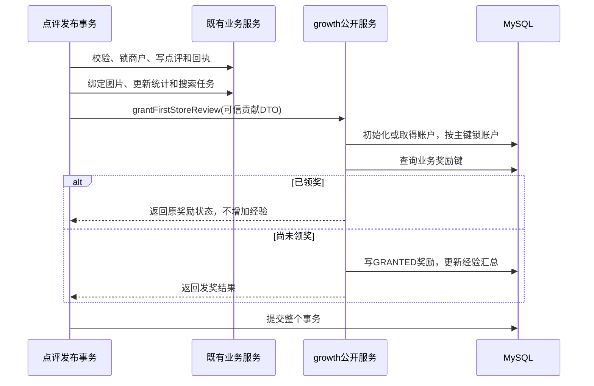

# 简单等级与成长奖励一致性设计

日期：2026-11-07。状态：V24结构及每店首次点评计奖闭环已实现，包含内部幂等撤销、等级计算和本人查询接口；源码已完成隔离MySQL验证，本地运行实例已按用户要求启动最新代码用于联调。个人中心、成长详情及本人主页已展示真实经验或数字等级；审核通过奖励已接入；点评获赞奖励已接入；点评双排序及内部批量等级查询已接入，作者及登录可见主页等级展示已接入，执行与验证情况见[开发记录](../development.md)。字段、索引和约束统一见[成长经验表结构](../architecture/mysql-schema.md#growth-schema)，业务决定见[社区讨论记录](community-rules.md#等级体系)。

## 当前基础与第一个交付

现有[点评发布服务](../../backend/src/main/java/com/ginkgo/foodmap/review/service/ReviewWriteService.java)使用独立事务执行完整尝试，包含商户锁、请求回执、图片绑定、评分统计及搜索任务；失败后在事务外有限重试。[本人删评服务](../../backend/src/main/java/com/ginkgo/foodmap/review/service/ReviewDeleteService.java)永久删除点评，但保留请求回执。[申请审核服务](../../backend/src/main/java/com/ginkgo/foodmap/restaurant/service/RestaurantRequestReviewService.java)将商户发布、相册和审核结果放在同一事务中。

已完成首个交付：新提交成功的点评 → 按每用户每店的一次奖励资格记经验 → 查询本人累计经验和数字等级。奖励记录不随点评删除，以保证删评重发不再次领奖。已存在发布请求的重放分支不补发历史奖励。成长核心包含幂等撤销能力及测试，真实违规处置入口随后接入。

审核贡献已接入同事务计奖；点赞日额度已接入，双排序已接入；点评和回复点赞的整体需求仍见INT-001，本文涉及获赞经验的部分只针对点评。

## 必须保持的数据约束

| 编号 | 约束 | 验证方式 |
| --- | --- | --- |
| G1 | 同一业务奖励资格最多产生一次有效发放，换请求编号也不增加资格。 | 业务唯一键、顺序及并发重复调用测试。 |
| G2 | 业务事实、奖励记录和经验汇总在同一个事务提交或回滚。 | 在各写入位置注入失败，比较提交前后完整状态。 |
| G3 | 每笔原奖励最多撤销一次，金额取原来实际发放值。 | 账户锁内检查及条件更新奖励状态，重复撤销与改配置后撤销测试。 |
| G4 | 每个账号的汇总经验等于其GRANTED奖励的amount之和，且不得为负。 | 同一读取快照内核对汇总与有效奖励；禁止以强制归零掩盖不一致。 |
| G5 | 普通取消点赞或本人删评不删除、撤销成长奖励记录。 | 取消重赞、硬删除重发回归。 |
| G6 | 获赞经验同时满足单个点赞者对作者的日次数限制和作者日总上限；额度不足时正常点赞仍可提交。 | 点赞阶段的多参与者并发及跨日测试。 |

这些约束描述本库内的持久化结果，不承诺网络请求或未来消息投递只发生一次。

## 模块与协作

新增`growth`业务模块，拥有经验账户和奖励记录；规则放`policy`，初始参数放类型化配置。延续controller/service/mapper分层，不引入全局业务工具类。

| 已实现协作入口 | 职责与事务要求 |
| --- | --- |
| `GrowthRewardApplicationService` | 接受业务模块确认过的贡献DTO，判断奖励资格并记账；`Propagation.MANDATORY`，强制加入调用方事务。 |
| `GrowthRewardApplicationService.revoke` | 接受可信处置引用，按原奖励撤销；与内容状态变更共用事务。 |
| `GrowthQueryService` | 读取经验、计算等级，提供本人查询和内部批量等级查询；不修改奖励数据。 |

点评及商户模块传递服务端确定的作者、对象ID和贡献类型，不传持久化Entity。growth不直接查询其他模块的Mapper或表；业务模块负责权限、对象状态与贡献真实性检查，成长模块负责计奖规则与账目正确性。

客户端不提交发奖金额、经验值、受益人或撤销指令。成长写服务只作为内部协作入口；账号处罚仍由原风控职责处理。

## 已完成的表结构

用户已接受两表方案并授权先创建表：growth_accounts保存经验汇总，growth_rewards保存一次发奖和最多一次撤销事实。V24的具体字段、取值、索引和同模块外键见[结构文档](../architecture/mysql-schema.md#growth-schema)，本计划不再重复维护字段清单。

用户、点评、申请和处置ID均为跨模块逻辑引用，不建立跨模块外键或级联删除。奖励表只存业务引用，不复制点评正文、照片或举报者身份；内容证据由风控模块管理。普通删评不删除奖励记录，撤销也保留原奖励记录及唯一键。

汇总经验是有效奖励合计的查询加速结果；第一版等级由经验及当前固定门槛计算，不额外维护等级列。奖励保存当时实际发放的amount；撤销和对账直接使用该值，不按当前计奖配置重新计算历史贡献。

### 简化的依据与边界

- 去掉账户revision：当前采用账户行锁串行化同用户的成长写入，没有无锁并发覆盖或异步投影版本比较需求。updated_at只用于显示及排查，不作为替代版本号。
- 去掉逐笔rule_version：它服务于精确历史规则追溯，不能被行锁替代；但当前没有在线规则编辑或按旧规则重放需求。计奖配置随代码发布管理，奖励amount独立保留。该取舍保留实际奖励结果，但不承诺从单条记录完整还原当时所有规则条件。
- 暂不创建growth_ledger：当前每笔奖励只发放一次、最多撤销一次，奖励记录保存发放事实和撤销事实已足够；需要查看增减历史时，可分别取granted_at和revoked_at展示。若以后引入部分撤销、反复恢复、人工多次调整或完整追加事件历史，再评估独立流水。
- 唯一键继续保留：行锁只保护当前事务的并发执行，奖励记录及唯一键负责跨请求、跨时间的业务去重。

完整配置追溯、异步版本比较和多阶段奖励调整未纳入本方案，不因当前简化而声称已具备这些能力。

### 请求去重与奖励去重

| 奖励类型 | 业务键建议 | 业务引用 |
| --- | --- | --- |
| 每用户每店首次点评 | `restaurant_id`，用户及类型已在唯一键中 | 实际获得奖励的点评ID。 |
| 新店投稿通过 | `request_id` | 审核申请ID；受益人为原提交者，不是审核管理员。 |
| 纠错通过 | `restaurant_id`，用户及类型已在唯一键中 | 首次获得该店纠错奖励的申请ID；不同申请不释放同人同店资格，见LEVEL-013。 |
| 点评获赞 | 服务端编码的`review_id + liker_user_id` | 被赞点评ID及真实点赞者；日额度额外约束。 |

业务键采用有界、无歧义编码及精确比较，不接受客户端任意字符串。不使用HTTP请求UUID替代每店奖励资格；普通删评后，原奖励记录和唯一键继续存在。

## 发奖事务与锁顺序

成长模块不新开独立提交的写事务。首个点评闭环接入现有发布事务的末端，保持现有资源锁顺序，成长账户之后不再回头获取业务资源锁。

1. 业务锁在前。发评沿用商户→回执/媒体/统计等既有顺序；审核保留现有商户与申请锁顺序；所有相关写操作完成后才进入成长写服务。
2. 成长内部统一先锁账户，再查询、写入或更新该账户奖励，最后更新经验汇总。同一账号的发奖、撤销、日奖励资格检查及汇总修复都遵循账户行互斥；首版接受同账号写入串行，以换取易验证的结果。
3. 账户首次创建与后续锁定要覆盖多事务同时初始化；不依据数据库驱动对无变化UPDATE的受影响行数判断是否已经发奖。唯一键负责最终兜底，正常重复资格在账户锁内返回已有结果。
4. 不在成长写服务中捕获SQL异常后继续提交。由拥有业务事务的入口决定回滚和重试；每次尝试必须已经完整结束后再进行下一次。
5. 锁超时、死锁、唯一键冲突分别分类，有限重试；参数非法、权限失败、业务键内容冲突及数据约束损坏不作为瞬态错误重试。重复业务键若映射到其他合法点评，应作为“同店已奖励”，不要求source_id相同；同一源事实的类型、受益人等矛盾才属于异常。

现有发评已有三次完整事务尝试；新逻辑加入此边界，不叠加成长内部重试。审核入口当前没有等同的显式重试循环，接入奖励时需独立验证其并发初始化和错误返回，不能宣称已具备发评相同的自动重试能力。

## 撤销、普通删除与规则调整

奖励状态转换为：无奖励→GRANTED→REVOKED；普通删评和取消点赞不触发状态转换。撤销时先由业务模块完成有效的违规处置校验及必要的资源锁定，再锁成长账户，读取原奖励。

原奖励已撤销时返回已完成结果；尚未撤销时，在账户锁内条件更新GRANTED→REVOKED，记录revoked_at和disposition_id，并按原amount扣减账户，整体提交。状态未发生有效转换时不再次扣经验。源内容已硬删除时，仍能通过保留的奖励来源ID关联，不能因查不到点评正文而清除奖励记录。原amount、来源及granted_at保持不变，证据副本仍由风控管理。

原奖励不存在时不凭当前规则臆造扣款；账户余额不足或奖励状态关系不符时停止本次事务并暴露一致性错误，不以归零后继续提交掩盖问题。第一版不提供任意修改经验的管理接口。

后续对账应在同一读取快照内核对账户经验与该用户status=GRANTED的amount合计，避免把并发提交造成的两次不同读取误判为损坏。用户级修复应使用独立维护事务，先锁账户，再按READ_COMMITTED读取有效奖励重新聚合，校验后更新经验。当前仅在集成测试中用独立SQL核对奖励合计，独立对账与修复工具未实现；修复不应重新触发历史贡献计奖或把当前配置回套到旧奖励。

## 点赞日额度

点赞仍由review拥有关系及内容有效性校验。奖励记录已增加真实点赞者actor_user_id和业务日期business_date，并按实际查询补充日奖励查询索引；没有独立日资格表或日汇总表。

在受益人账户锁内，先检查同一点赞者当日对该作者已获得奖励的次数，再合计作者当日获赞奖励的amount；符合两项限制才插入新奖励并增加经验。所有该作者的奖励写入经过同一账户锁，检查与写入在同一事务内完成；保留每条点评每个点赞者的奖励业务唯一键。写事务统一采用READ_COMMITTED，接入时验证外层隔离级别，不假设MANDATORY会自动改变调用方的隔离级别。额度聚合默认不因记录改为REVOKED就自动释放，具体返还口径需在后续业务确认后确定。

该方案的代价是每次计奖增加当日奖励查询，以及同受益人写入等待；先按实际数据验证索引和耗时，有可复现瓶颈时再评估额度表。

业务日期使用Asia/Shanghai自然日，时间戳存UTC；一次动作取一个服务端时刻，同次内部重试复用该时刻，已提交动作的重试复用原结果。使用带日期的记录分桶，避免依赖午夜统一清零任务；通过传入服务端动作时刻验证跨日情况。

额度不足属于“点赞成功、此次不奖励经验”的正常结果，不抛异常回滚正常点赞。数据库错误则结束整个事务，让客户端以同一业务身份重试。第一版计奖以MySQL为准，避免另一个存储中的额度预扣与数据库提交产生第二套恢复协议。

## 已实现的读取接口

本人摘要接口已加入现行[API契约](../api.md#14-本人成长摘要)：

| 入口 | 认证与结果 |
| --- | --- |
| `GET /api/me/growth` | 认证后仅查本人；返回累计经验、数字等级、当前及下一等级门槛；无成长账户时返回零经验和对应初始等级。 |

内部批量等级查询已实现：仅接收可信服务传入的作者逻辑ID，每批最多500个账户，无账户按零经验计算，不创建账户；不开放任意用户经验或奖励明细HTTP接口。默认排序先取得当前店所有作者的等级，再以绑定参数交由review查询完成全局排序与分页，不跨模块联表。

没有经验写入或任意用户奖励明细查询API。本人查询使用现有JWT、会话及数据库账号状态校验；目前停用账号仍按现有认证规则拒绝访问，受限登录及申诉页面尚未实现，不因新增查询入口扩大停用账号权限。

计奖分值由app.growth.first-review-experience、new-store-experience、correction-experience及like-experience控制，获赞日经验上限由app.growth.daily-like-experience-limit控制，数字等级门槛由app.growth.level-thresholds控制，支持GROWTH_FIRST_REVIEW_EXPERIENCE、GROWTH_NEW_STORE_EXPERIENCE、GROWTH_CORRECTION_EXPERIENCE、GROWTH_LIKE_EXPERIENCE、GROWTH_DAILY_LIKE_EXPERIENCE_LIMIT和GROWTH_LEVEL_THRESHOLDS环境变量覆盖。配置必须为正奖励及从0开始严格递增的非空门槛，否则启动失败；调整随部署生效，不回算旧奖励。

## 失败场景与验收

| 场景 | 必须验证的结果 | 阶段 |
| --- | --- | --- |
| 同一发布请求提交成功但响应丢失后重试 | 复用发布回执，只有一笔奖励、一次经验增加。 | 首个闭环 |
| 同账号同店用不同UUID顺序或并发发评 | 点评按原规则处理，奖励仅一次。 | 首个闭环 |
| 同账号同时点评不同店 | 所有有效奖励正确累计，账户首次创建无丢失更新。 | 首个闭环 |
| 写奖励或汇总后分别注入异常 | 点评、图片绑定、评分、搜索任务与成长数据均回到事务前状态。 | 首个闭环 |
| 本人删评后重新发布 | 业务回执沿用既有语义，成长奖励仍不重复，原经验不扣。 | 首个闭环 |
| 对原奖励重复或并发撤销 | 仅发生一次GRANTED→REVOKED及一次净扣除，原发放事实保留，重复调用结果可识别。 | 成长核心 |
| 原发奖分值调整后再撤销 | 扣回原实际发放金额，不按新配置扣减。 | 成长核心 |
| 对隔离测试库的汇总故意制造差异 | 对账能发现，按同账户锁协议从有效奖励重建后结果一致。 | 成长核心 |
| 同点赞者并发点赞同作者的多篇点评 | 日奖励次数不超限，其他点赞仍成功。 | 点赞接入 |
| 多点赞者争抢同作者剩余日额度 | 日获赞经验不超总上限，无失败事务占用额度。 | 点赞接入 |
| 午夜边界、事务重试及已完成动作重放 | 同一动作日期和奖励结果稳定，新动作进入对应日期桶。 | 点赞接入 |
| 点赞与已确认违规处置并发 | 在统一源状态及锁顺序下验证发奖、停止奖励与撤销的最终结果。 | 风控接入 |

纯规则用单元测试覆盖门槛边界、参数校验及撤销金额；锁、唯一约束、回滚与重试使用隔离真实MySQL库验证，记录实际数据库版本。当前已有[真实点评集成测试基础](../../backend/src/test/java/com/ginkgo/foodmap/review/ReviewWriteApiIntegrationTest.java)。故障注入应分别覆盖业务提交前失败与提交成功后响应失败，两者预期不同；测试失败要保留可复现条件，不以重复运行通过代替原因分析。

首个发评闭环和成长核心的发放、撤销、配置调整及异常回滚已有自动化验证，执行数量及环境见[开发记录](../development.md)。表中的汇总重建工具、真实风控接入仍未实现；当前只验证了余额损坏时拒绝撤销，不声称已完成修复工具。没有本功能吞吐量或性能提升结论。

## 后续步骤与待定边界

| 步骤 | 可独立审核的结果 |
| --- | --- |
| 结构阶段（已完成） | V24两表迁移、结构约束及V23升级验证，本地开发库已执行，两表为空。 |
| 1（已完成） | 成长核心计奖及撤销服务、等级计算、同账户并发与回滚测试。 |
| 2（已完成） | 接入发评奖励与本人等级查询，验证首次点评、重放及删评重发闭环。 |
| 3（已完成） | 审核奖励与商户、相册、搜索任务、审核状态同提交/回滚；新店按申请计奖，纠错每人每店一次，重放及历史已通过申请不补发。 |
| 4（已完成） | 点赞关系、日奖励额度与获赞经验；回复点赞不计成长经验，仍在原社区功能范围。 |
| 5（部分完成） | 本人页面数字等级及进度、默认/时间双排序及分页前批量等级数据获取已接入；作者及公开主页数字等级展示已接入。 |
| 6 | 举报处置中的经验撤销与申诉告知联动，保留等级和账号状态的职责边界。 |

不阻塞步骤1～2、但在相关接入前需确认：超限点赞是否存在之后补发经验的资格；违规撤销后日奖励额度是否返还；每店奖励被撤销后是否允许另一条合规点评恢复该奖励。当前技术方案不开放自动补发、返还或恢复流程，也不把未确认行为写成正式规则。

默认排序优先级见LEVEL-011；本次采用请求内REPEATABLE_READ快照，跨请求随当前点赞数、等级和最新代表变化而重新排序，不承诺跨页固定快照。时间排序复用原SQL；默认排序先查询当前店作者ID，由growth服务分批读取等级，再将等级以CASE绑定参数传给review查询，按最新代表的有效点赞、等级、时间、ID排序后LIMIT。复用现有点赞目标索引，无新增迁移、Redis排名或ES点评索引。代价是等级读取与SQL参数量随当前店作者数增长，未声明大规模性能目标；出现实际瓶颈后再评估排序投影或短期快照。

## 方案取舍与依据

同库同步事务便于将业务和奖励一起回滚，代价是业务请求承担计奖耗时及同账号锁等待；首版先验证这条边界，现有搜索Outbox继续用于既有跨系统投影。若未来确有独立部署或异步处理需求，再设计持久任务、重试和补偿，不以进程内回调代替可靠投递。

普通事务传播可参与同一物理事务，见[Spring事务传播](https://docs.spring.io/spring-framework/reference/data-access/transaction/declarative/tx-propagation.html)。成长写服务采用强制加入现有事务的公开协作入口，与现有RestaurantReviewApplicationService的做法一致。

[Spring事务事件说明](https://docs.spring.io/spring-framework/docs/current/javadoc-api/org/springframework/transaction/event/TransactionalEventListener.html)指出AFTER_COMMIT执行时原事务已完成，因此不把经验发放放到默认提交后监听中。另开事务发奖会引入业务已成功而奖励失败的恢复责任，当前同库方案采用同步调用。

[MySQL错误处理说明](https://dev.mysql.com/doc/refman/8.4/en/innodb-error-handling.html)区分死锁与锁等待超时的回滚粒度；本设计统一由外层业务入口结束失败事务后重试，并单独验证错误分类与重试耗尽结果。
